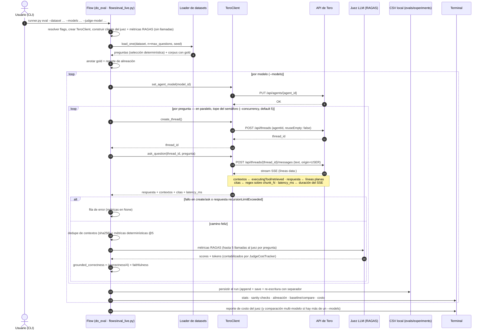

# Flujo del runner de evaluación RAG (index → eval live)

Este documento describe el flujo real del framework de evaluación RAG de Tero. El entry point sigue siendo `scripts/rag_eval/runner.py` (solo CLI); la lógica vive repartida en el paquete `scripts/rag_eval/` (`config.py`, `judge.py`, `metrics/`, `reporting/`, `flows/`). Cubre los subcomandos `index` (pre-indexado del corpus) y `eval` en **modo live** (contra la API de Tero).

**Fuera de alcance:** modo offline `eval --from-csv`, `pool-probe`, `smoke_test`, `analysis.py` en modo pareado y `export_datasets.py`.

_Verificado contra el código el 2026-10-16 (post split modular; `runner.py` = CLI de 146 líneas + paquete `flows/`). Las referencias de verificación están al final._

## 0. Estructura de módulos (post-refactor, 2026-10-16)

```
scripts/rag_eval/
  runner.py            # CLI: build_parser + main + dispatch (python runner.py <cmd> sigue siendo el entry)
  config.py            # paths, .env, banner reranker, bootstrap de sys.path
  judge.py             # cliente juez, pricing, JudgeCostTracker, cost_report
  metrics/
    deterministic.py   # métricas @5 (doc/sentence/coverage/table/cell recall)
    gold.py            # anotación gold, alineación, relevant_chunk_index
    ragas.py           # _build_metrics, pairing de citas
    sample.py          # pipeline por pregunta (_process_question_result, _compute_metrics_from_sample)
  reporting/
    csv_io.py          # parseo/validación CSV, conversión a separador ';'
    baseline.py        # comparabilidad y persistencia de baselines
  flows/
    index.py           # do_index
    eval_live.py       # do_eval
    eval_csv.py        # _run_csv_mode (offline)
    probe.py           # do_pool_probe + gate del probe
  [sin cambios] tero_client.py · rag_datasets.py · analysis.py · sanity_checks.py ·
                retrieval_matching.py · smoke_test.py · pool_probe.py · export_datasets.py
```

Los cuerpos de los flows son movimientos verbatim del `runner.py` original (verificado por AST en cada tarea; ver `odd/tasks/rag-eval-module-split.md`). La regla REQ-OFFLINE-009 sigue vigente: `flows/eval_csv.py` no importa `tero_client`.

## 1. Flujo macro: index → eval (live)

> `index` y `eval` son invocaciones separadas. `eval` live asume un agente ya pre-indexado y no sube documentos: solo cambia el modelo del agente y mide.

```mermaid
flowchart TD
    subgraph IDX["1 · index — pre-indexado del corpus (una corrida por dataset)"]
        A["CLI: runner.py index<br/>--dataset · --agent-id · --max-docs"] --> B["Cargar corpus completo<br/>rag_datasets.load_one(n=0)"]
        B --> C["Estimar tokens de embedding<br/>tiktoken local (cl100k_base)"]
        C --> D["Limpiar agente<br/>esperar procesamiento pendiente, borrar archivos y tool docs"]
        D --> E["Configurar tool de docs<br/>POST /api/agents/{agent_id}/tools<br/>skipDescriptions: true"]
        E --> F["Subir corpus<br/>doc_000000.txt, doc_000001.txt, ...<br/>POST /api/agents/{agent_id}/tools/docs/files (throttle 50 ms)"]
        F --> G["Esperar procesamiento (timeout 1800 s)"]
        G --> H{"¿Archivos en ERROR?"}
        H -- "sí (máx. 3 rondas)" --> I["Re-subir errores, esperar 120 s, borrar huérfanos"]
        I --> G
        H -- "no" --> J["Reporte de costo estimado<br/>(tokens de embedding + wall clock)"]
    end

    J --> K["CLI: runner.py eval (live)<br/>--models · --judge-model · --concurrency · --seed · --max-questions"]
    subgraph EVAL["2 · eval — medición por modelo (agente ya indexado, sin subidas)"]
        K --> L["Construir juez LLM y métricas RAGAS<br/>judge._build_judge_client · metrics.ragas._build_metrics"]
        L --> M["Cargar preguntas + corpus<br/>load_one(n=max_questions, seed) → selección determinística"]
        M --> N["Anotar gold de cada pregunta<br/>+ reporte de alineación"]
        N --> O["Por modelo (--models):<br/>PUT /api/agents/{agent_id} — set model"]
        O --> P["Abrir semáforo de concurrencia<br/>asyncio.Semaphore(--concurrency, default 5)"]
        P --> Q["Por pregunta (en paralelo, hasta N)<br/>create_thread → ask_question (SSE)"]
        Q --> R{"¿Excepción en create/ask?<br/>¿respuesta recursionLimitExceeded?"}
        R -- "sí" --> S["Fila de error<br/>métricas en None (respuesta y contextos según el caso)"]
        R -- "no" --> T["Dedupe de contextos (sha256)"]
        T --> U["Métricas determinísticas @5<br/>doc_recall_5 · doc_coverage_5 · sentence_recall_5<br/>(FeTaQA: table_recall_5 · cell_recall_5)"]
        U --> V["Métricas RAGAS (juez LLM)<br/>context_recall · context_precision · faithfulness<br/>correctness · citation_faithfulness"]
        V --> W["grounded_correctness = (correctness/4) × faithfulness"]
        S --> X["Persistir CSV del run<br/>evals/experiments/{dataset}/{model_id}_{timestamp}_{uuid}"]
        W --> X
        X --> Y["Stats + sanity checks<br/>(re-guardado si parametric_suspect)"]
        Y --> Z["--update-baseline: guardar baseline<br/>--compare: comparar contra baseline"]
    end
    Z --> AA["Reporte final: summary · alineación · costo del juez · comparación multi-modelo si hay más de un modelo"]
```



## 2. Interacciones del eval live

Participantes y mensajes reales de una corrida `eval` contra Tero.



## Notas de fidelidad

- **Juez LLM**: default `gemini-3.5-flash`, enrutado por prefijo del modelo: `gemini*` → endpoint OpenAI-compatible de Google, `gpt*`/`o*` → OpenAI, `claude*` → Bedrock. Implementado en `judge.py`.
- **Sin embeddings en el eval live**: las cinco métricas RAGAS usan solo el juez LLM; ningún modelo de embeddings interviene. (Los embeddings de indexación corren en el backend; `pool-probe` es otro subcomando.)
- **Semilla**: `--seed` (default 14) solo decide qué preguntas se seleccionan; no hace reproducibles las respuestas.
- **Latencia**: `latency_ms` mide solo el SSE de `ask_question`; en filas de error incluye también el `create_thread`.
- **Concurrencia**: el semáforo envuelve `create_thread` + SSE + todas las métricas del juez: acota todo el procesamiento por pregunta.
- **Reintentos**: solo `create_thread` reintenta (3 intentos, errores de conexión previos al envío). `ask_question` no reintenta.

## Verificación contra el código

| Tramo | Evidencia |
|---|---|
| CLI: parser y dispatch | `runner.py:52` (`build_parser`) · `:134` (`main`) |
| `index` | `flows/index.py:15` (`do_index`) — cuerpo verbatim; lazy `tiktoken`/`TeroClient` preservados |
| `eval` live: orquestación | `flows/eval_live.py:31` (`do_eval`) |
| `eval` live: pipeline por pregunta | `metrics/sample.py:223` (`_process_question_result`) · `:57` (`_compute_metrics_from_sample`) |
| Métricas determinísticas @5 | `metrics/deterministic.py` (movidas verbatim) |
| RAGAS + grounded_correctness | `metrics/ragas.py:12` (`_build_metrics`) · `metrics/sample.py` |
| Juez + costos | `judge.py:287` (`_build_judge_client`) |
| CSV y separador `;` (eval live y CSV mode) | `reporting/csv_io.py:108` (`_csv_to_semicolon`) |
| Baselines / comparabilidad | `reporting/baseline.py:49` (`_load_baseline`) · `:56` (`_save_baseline`) |
| Sanity checks | `sanity_checks.py` (sin cambios; import lazy desde los flows) |
| Selección determinística | `rag_datasets.py:32-38` |
| Cliente HTTP: retries, create_thread, SSE, set model | `tero_client.py:24-27,212-246` · `:248-320` · `:201-206` (sin cambios) |
| Probe offline (fuera de alcance) | `flows/probe.py:104` (`do_pool_probe`) · `pool_probe.py` |

> La suite canónica del harness corre en WSL: `wsl -d Ubuntu bash -lc "cd /mnt/d/dev/tero && .venv/bin/python -m pytest scripts/rag_eval/ -q"`. Baseline documentado del refactor (2026-10-16): `10 failed, 548 passed` — los 10 fallos son pre-existentes (9 por fixtures ausentes en `evals/test_fixtures/`, 1 test stale de malformed JSON) y están catalogados en `odd/tasks/rag-eval-module-split.md`.
